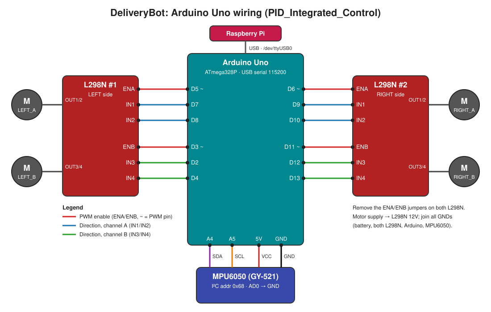
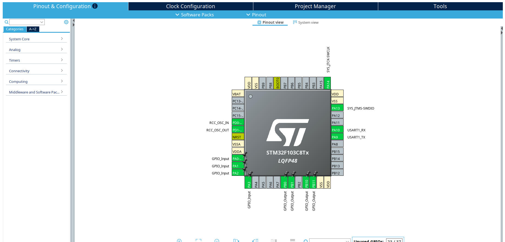

# Indoor Autonomous Robot for Delivery

**DeliveryBot** is a four-wheel indoor delivery robot built from low-cost embedded hardware. A Raspberry Pi acts as the high-level controller and talks over UART to two microcontrollers:

- an **Arduino Uno** that drives four DC motors through two L298N drivers and uses an **MPU6050** IMU to keep the robot on its heading, and
- an **STM32** board that reads four **HC-SR04** ultrasonic sensors (front, left, right, back) and streams the distances to the Pi.

This repository holds the firmware for both microcontrollers and the Python scripts that run on the Raspberry Pi. ROS integration and a web application are planned (see [Roadmap](#roadmap)).

---

## Table of contents

- [System architecture](#system-architecture)
- [Hardware](#hardware)
- [Repository structure](#repository-structure)
- [Firmware](#firmware)
  - [Arduino motor controller](#arduino-motor-controller)
  - [STM32 distance perception](#stm32-distance-perception)
- [Raspberry Pi controller](#raspberry-pi-controller)
- [Serial protocols](#serial-protocols)
- [Getting started](#getting-started)
- [Calibration and tuning](#calibration-and-tuning)
- [Troubleshooting](#troubleshooting)
- [Roadmap](#roadmap)

---

## System architecture

```
                    ┌──────────────────────────────┐
                    │        Raspberry Pi          │
                    │  Python mission / control    │
                    │  scripts (pyserial)          │
                    └──────┬───────────────┬───────┘
          USB serial       │               │   UART (GPIO, /dev/ttyS0)
          /dev/ttyUSB0     │               │   115200 8N1
          115200 baud      ▼               ▼
        ┌────────────────────────┐   ┌────────────────────────┐
        │      Arduino Uno       │   │         STM32          │
        │  Motion control +      │   │  Distance perception   │
        │  IMU heading recovery  │   │  (HAL, STM32CubeIDE)   │
        └───┬───────────────┬────┘   └───────────┬────────────┘
            │ I²C (A4/A5)   │ PWM + DIR          │ GPIO trig/echo
            ▼               ▼                    ▼
        ┌────────┐   ┌──────────────┐    ┌────────────────────┐
        │MPU6050 │   │ 2× L298N →   │    │ 4× HC-SR04          │
        │  IMU   │   │ 4× DC motors │    │ front/left/right/back│
        └────────┘   └──────────────┘    └────────────────────┘
```

**Division of work**

| Layer | Runs on | Responsibility |
|---|---|---|
| High-level control | Raspberry Pi (Python) | Menus and missions, timed movement chunks, yaw supervision, lateral-error-guided correction, sensor logging |
| Motion control | Arduino Uno (C++) | Parses `F/B/L/R/S` commands, applies per-side trim, integrates gyro yaw, stops and re-aligns when heading drifts |
| Perception | STM32 (C, HAL) | Triggers the four ultrasonic sensors one at a time and sends a CSV distance line every ~300 ms |

---

## Hardware

| Component | Qty | Role |
|---|---|---|
| Raspberry Pi | 1 | Main controller, runs the Python scripts |
| Arduino Uno | 1 | Motor and IMU controller |
| L298N dual H-bridge | 2 | One per side of the robot, each driving two motors |
| DC gear motors | 4 | Skid-steer drive (two per side) |
| MPU6050 (GY-521) | 1 | 3-axis gyro + accelerometer, used for yaw/heading |
| STM32F103C8T6 board ("Blue Pill", LQFP48) | 1 | Ultrasonic sensor controller |
| HC-SR04 ultrasonic sensor | 4 | Front, left, right and back distance |

### Arduino Uno pinout (current firmware: `PID_Integrated_Control`)




| Signal | Arduino pin | | Signal | Arduino pin |
|---|---|---|---|---|
| Left A PWM (ENA) | D5 | | Right A PWM (ENA) | D6 |
| Left A IN1 / IN2 | D7 / D8 | | Right A IN1 / IN2 | D9 / D10 |
| Left B PWM (ENB) | D3 | | Right B PWM (ENB) | D11 |
| Left B IN1 / IN2 | D2 / D4 | | Right B IN1 / IN2 | D12 / D13 |
| MPU6050 SDA | A4 | | MPU6050 SCL | A5 |

> The older `PID_Raw_Control` sketch uses a different mapping (left rear on D6/D9/D10, right front on D3/D2/D4). Check the `#define` block at the top of each sketch before flashing.

### STM32 pinout (`Robot Distance Perception`)

Pin configuration of the STM32F103C8T6 in STM32CubeIDE:




| Sensor | TRIG | ECHO |
|---|---|---|
| Front | PB0 | PA0 |
| Left | PB1 | PA1 |
| Right | PB10 | PA2 |
| Back | PB11 | PA3 |
| UART to Raspberry Pi | USART1 TX/RX (PA9/PA10) | 115200 8N1 |
| Debug / programming | SWDIO PA13, SWCLK PA14 | ST-Link |

ECHO pins are configured as inputs with pull-down. TIM2 is used as a 1 MHz microsecond timer (prescaler 7 with the 8 MHz HSI clock; use 71 at 72 MHz).

> HC-SR04 ECHO outputs 5 V. Use 5 V-tolerant STM32 pins or a voltage divider / level shifter. Likewise, use a level shifter between the STM32 and the Raspberry Pi UART if either side is not 3.3 V.

---

## Repository structure

```
.
├── Embedded Software /
│   ├── PID Motor Control/                  Arduino Uno firmware
│   │   ├── PID_Integrated_Control/         ★ Current firmware: trim-only driving + IMU yaw-threshold recovery
│   │   │   ├── pid_integration_turnLogic.ino
│   │   │   ├── mpu6050.hpp / mpu6050.cpp   DeliveryBotMPU6050 class (gyro calibration, yaw integration)
│   │   ├── PID_Raw_Control/                Early PID heading-hold test (Kp/Ki/Kd on yaw)
│   │   │   ├── PID_Control.ino
│   │   │   ├── mpu6050.hpp / mpu6050.cpp   Register-level MPU6050 driver + complementary filter
│   │   ├── Trim Motor Control/
│   │   │   └── imusuz_sag_sol_test.ino     IMU-free motor test used to find trim values
│   │   └── PID_Control.ino, mpu6050.*      Copy of PID_Raw_Control (kept for history)
│   ├── Robot Distance Perception/          STM32 firmware (HAL)
│   │   ├── main.c                          CubeMX main: GPIO, TIM2, USART1, sensor loop
│   │   ├── hcsr04.h / hcsr04.c             Multi-sensor HC-SR04 driver
│   ├── STM32 Sensor Data Reading/          (placeholder)
│   └── Raspberry PI UART Communication/    (placeholder)
├── RaspberryPI Contoller /                 Raspberry Pi scripts (set 1)
│   ├── guided_motor_control_all_options.py Menu controller + file-guided lateral correction
│   ├── imu_supervised_forward.py           Forward in short steps, correct on yaw drift
│   ├── send_arduino_motor_command.py       Minimal interactive serial terminal for the Arduino
│   ├── read_stm32_sensors.py               Live print of STM32 distance data
│   └── record_stm32_sensors_csv.py         Log STM32 distance data to CSV
├── RaspberryPI Contoller/                  Raspberry Pi scripts (set 2)
│   ├── mission_control.py                  Menu: drive, turn, PID forward (P/G), reset yaw (Z)
│   ├── mission_control_balanced.py         Same, with left/right speed balancing
│   ├── manual_imu_robot_controller.py      Manual drive + yaw-supervised forward
│   └── long_forward_imu_controller.py      Long forward runs in chunks with tiered yaw correction
├── Robot Operating System/                 (placeholder, planned ROS integration)
└── Web Application/                        (placeholder, planned web UI)
```

> **Note on folder names:** some folders contain a trailing space (`Embedded Software `, `RaspberryPI Contoller `), and there are two Raspberry Pi folders whose names differ only by that space. Quote paths in the shell, e.g. `cd "RaspberryPI Contoller /"`. The files named `a` are empty placeholders that keep otherwise-empty folders in Git.

---

## Firmware

### Arduino motor controller

**Current sketch:** `Embedded Software /PID Motor Control/PID_Integrated_Control/pid_integration_turnLogic.ino`

How it moves the robot:

1. **Trim-only straight driving.** Forward and backward commands add a fixed per-side trim (`STRAIGHT_LEFT_TRIM = +20`, `STRAIGHT_RIGHT_TRIM = -10`) so that both sides travel at the same real speed. The IMU does *not* modulate PWM continuously.
2. **Yaw supervision.** On boot the gyro is calibrated (keep the robot still), then `DeliveryBotMPU6050::update()` integrates the gyro Z rate into a yaw angle every loop. When an `F`/`B` command starts, the current yaw becomes the target heading.
3. **Threshold recovery.** If the heading error reaches `YAW_CORRECTION_THRESHOLD_DEG` (5°), the robot stops for 2 s, turns briefly in the opposite direction (30 ms per degree, clamped to 160–450 ms), pauses 300 ms and then drives the *remaining* time. Correction time is not counted as driving time. Corrections are rate-limited (min 1.5 s after start, 3 s apart, max 5 per command).
4. **Turns** (`L`/`R`) are open-loop timed spins with their own trim (the right turn is slowed by 38 PWM to match the left).

Boot messages end with `READY`. Each finished command prints `DONE`. With `ENABLE_CORRECTION_DEBUG 1`, the sketch also prints `DRIVE | Target: … | Yaw: … | Error: …` every 500 ms and `CORRECTION_TRIGGER` / `CORRECTION_DONE` lines.

**Other sketches**

| Sketch | Purpose |
|---|---|
| `PID_Raw_Control/PID_Control.ino` | First closed-loop attempt: PID on yaw (`Kp=3.0, Ki=0, Kd=0.4`, base speed 140, max correction 70) in a fixed 5 s drive / 3 s stop cycle. No serial commands. |
| `Trim Motor Control/imusuz_sag_sol_test.ino` | IMU-free version of the command interface, used to find the trim values that the current sketch keeps. |

### STM32 distance perception

**Source:** `Embedded Software /Robot Distance Perception/` (`main.c`, `hcsr04.c`, `hcsr04.h`)

- `HCSR04_Init(&htim2)` starts TIM2 as a 1 MHz counter used for microsecond delays and echo timing.
- `HCSR04_Read_All()` triggers the four sensors **one after another** with 60 ms gaps to avoid ultrasonic crosstalk.
- Distance is `echo_time_us / 58` cm. A sensor that does not answer within 50 ms reports `999` and an error status.
- The main loop sends one CSV line over USART1 every ~300 ms (see [Serial protocols](#serial-protocols)). `Print_Sensor_Readings()` is also available for a human-readable debug line.

The files are the user-code parts of an STM32CubeIDE project (HSI 8 MHz system clock, TIM2 prescaler 7, USART1 at 115200).

---

## Raspberry Pi controller

All scripts use `pyserial` and are interactive command-line tools.

| Script | Talks to | What it does |
|---|---|---|
| `RaspberryPI Contoller /guided_motor_control_all_options.py` | Arduino | Main menu controller. Manual drive/turn with base power + left/right difference, a test sequence, and **file-guided correction**: drives in short chunks and reads `lateral_error.txt` between chunks; negative error (too far left) turns right, positive turns left. Accepts the port as an argument. |
| `RaspberryPI Contoller /send_arduino_motor_command.py` | Arduino | Raw `motor>` prompt that forwards whatever you type and prints the reply. `q` sends `S` and exits. |
| `RaspberryPI Contoller /imu_supervised_forward.py` | Arduino | Drives forward in 300 ms steps for 10 s, reads `Yaw=` from the Arduino output and applies small/big corrective turns at 4°/7°. |
| `RaspberryPI Contoller /read_stm32_sensors.py` | STM32 | Prints front/left/right/back distances as they arrive. |
| `RaspberryPI Contoller /record_stm32_sensors_csv.py` | STM32 | Same, and writes them with timestamps to `sensor_logs/sensor_log_<date>.csv`. |
| `RaspberryPI Contoller/mission_control.py` | Arduino | Menu with forward/backward/turns, PID forward with (`P`) and without (`G`) yaw reset, reset yaw (`Z`), custom and raw commands. |
| `RaspberryPI Contoller/mission_control_balanced.py` | Arduino | Same as above, with a left/right motor difference applied to each move. |
| `RaspberryPI Contoller/manual_imu_robot_controller.py` | Arduino | Manual driving plus a yaw-supervised forward mode. |
| `RaspberryPI Contoller/long_forward_imu_controller.py` | Arduino | Long forward runs in 1 s chunks with a 5° deadband and tiered corrections at 10° / 18°. |

> **Firmware compatibility:** the scripts that parse `Yaw=` lines or send `P`, `G` or `Z` (the IMU-supervised scripts and both `mission_control` scripts) were written against a PID firmware revision that printed lines like `PID,Yaw=-3.39,Target=0.00,Error=3.39,…` and accepted those commands. The current `PID_Integrated_Control` sketch only accepts `F/B/L/R/S` and does its own yaw correction, so use it with `guided_motor_control_all_options.py` or `send_arduino_motor_command.py`.

---

## Serial protocols

### Raspberry Pi → Arduino (USB, `/dev/ttyUSB0`, 115200 baud, newline-terminated)

| Command | Meaning |
|---|---|
| `F <left> <right> <ms>` | Forward with left/right PWM (0–255) for `ms` milliseconds (yaw-supervised) |
| `B <left> <right> <ms>` | Backward, same as above |
| `L <left> <right> <ms>` | Spin left in place (open loop) |
| `R <left> <right> <ms>` | Spin right in place (open loop) |
| `S` | Stop immediately |

Example: `F 200 200 20000` drives forward for 20 s of actual driving time. Replies: `ACK …` on accept, `DONE` when finished, `ERR BAD_COMMAND` / `ERR UNKNOWN_COMMAND` on bad input. A duration of `0` runs until `S`.

### STM32 → Raspberry Pi (UART, `/dev/ttyS0`, 115200 8N1)

One line every ~300 ms:

```
FRONT,LEFT,RIGHT,BACK,STATUS
35,42,28,999,1
```

Distances are in centimetres. `STATUS` is `0` when all sensors read OK and `1` if any sensor timed out (that sensor reports `999`).

---

## Getting started

### 1. Flash the Arduino Uno

1. Install the [Arduino IDE](https://www.arduino.cc/en/software) (or `arduino-cli`). Only the built-in `Wire` library is needed.
2. Open `Embedded Software /PID Motor Control/PID_Integrated_Control/pid_integration_turnLogic.ino`. The `.ino` file must sit in a folder with the same name for the IDE, so either let the IDE create one (and copy `mpu6050.hpp` / `mpu6050.cpp` next to it) or rename the sketch to `PID_Integrated_Control.ino`.
3. Select **Arduino Uno**, choose the port and upload.
4. Open the Serial Monitor at **115200** baud with newline line endings. Keep the robot still until it prints `GYRO_CALIBRATION_DONE` and `READY`, then try `F 150 150 1000`.

With `arduino-cli`:

```bash
cd "Embedded Software /PID Motor Control/PID_Integrated_Control"
mv pid_integration_turnLogic.ino PID_Integrated_Control.ino   # sketch name must match the folder
arduino-cli compile --fqbn arduino:avr:uno .
arduino-cli upload  --fqbn arduino:avr:uno -p /dev/ttyACM0 .
```

### 2. Build and flash the STM32

1. In **STM32CubeIDE**, create a project for the **STM32F103C8Tx** and configure it in CubeMX to match `main.c`:
   - SYSCLK from HSI (8 MHz)
   - **TIM2**: internal clock, prescaler `7`, period `65535` (1 MHz tick)
   - **USART1**: asynchronous, 115200, 8N1
   - **GPIO**: PB0, PB1, PB10, PB11 as push-pull outputs (TRIG); PA0–PA3 as inputs with pull-down (ECHO)
2. Copy `hcsr04.h` into `Core/Inc/`, `hcsr04.c` into `Core/Src/`, and merge the `USER CODE` sections of `main.c` into your generated `main.c` (or replace it if the configuration is identical).
3. Build and flash with an ST-Link.
4. Connect a USB-UART adapter or the Pi to USART1 and check that CSV lines appear at 115200 baud.

### 3. Set up the Raspberry Pi

```bash
sudo apt update
sudo apt install -y python3-serial      # or: pip install pyserial

# Allow your user to use serial ports, then reboot
sudo usermod -aG dialout $USER
sudo reboot
```

For the STM32 link on the GPIO UART (`/dev/ttyS0`): run `sudo raspi-config` → *Interface Options* → *Serial Port*, disable the login shell over serial and enable the serial hardware. Wire STM32 TX → Pi RX (GPIO15), STM32 RX → Pi TX (GPIO14), and a common GND.

### 4. Run

```bash
# Read the ultrasonic sensors
python3 "RaspberryPI Contoller /read_stm32_sensors.py"

# Log them to CSV (written to ./sensor_logs/)
python3 "RaspberryPI Contoller /record_stm32_sensors_csv.py"

# Drive the robot from a menu (optionally pass the Arduino port)
python3 "RaspberryPI Contoller /guided_motor_control_all_options.py" /dev/ttyUSB0

# Or send raw commands
python3 "RaspberryPI Contoller /send_arduino_motor_command.py"
```

Ports and baud rates are defined as constants at the top of each script (`ARDUINO_PORT`, `SERIAL_PORT`, `BAUD_RATE`). `guided_motor_control_all_options.py` also has `DEFAULT_ERROR_FILE`, which points to a path on the original Pi; change it to a path on your system before using the file-guided modes.

---

## Calibration and tuning

All tuning values are `#define`s at the top of `pid_integration_turnLogic.ino`.

1. **Motor direction.** If a wheel spins the wrong way, flip its `*_DIR` value (`1` / `-1`).
2. **Straight-line trim.** Run `F 150 150 3000` with `USE_SEGMENTED_YAW_CORRECTION 0`. Adjust `STRAIGHT_LEFT_TRIM` / `STRAIGHT_RIGHT_TRIM` until the robot drives straight. The `Trim Motor Control` sketch is handy for this.
3. **Turn balance.** Compare `L 200 200 1000` and `R 200 200 1000` and adjust the `TURN_*_TRIM` values until both turn by the same angle.
4. **Yaw sign.** Rotate the robot left by hand while watching the debug output. If yaw decreases, set `YAW_LEFT_POSITIVE_SIGN` to `-1`.
5. **Recovery behaviour.** Tune `YAW_CORRECTION_THRESHOLD_DEG`, `CORRECTION_TURN_MS_PER_DEG`, `CORRECTION_TURN_MIN_MS` / `MAX_MS` and `CORRECTION_TURN_PWM`.
6. Set `ENABLE_CORRECTION_DEBUG 0` for normal runs; serial printing slightly affects loop timing.

---

## Troubleshooting

| Symptom | Fix |
|---|---|
| `IMU_INIT_FAILED_STATUS_…` on boot | Check MPU6050 wiring: VCC, GND, SDA → A4, SCL → A5, address 0x68 (AD0 low). |
| Robot drifts or corrects the wrong way | Re-check `*_DIR`, straight trims and `YAW_LEFT_POSITIVE_SIGN` (see [Calibration](#calibration-and-tuning)). |
| `Could not open /dev/ttyUSB0` / permission denied | `sudo usermod -aG dialout $USER` and reboot (or `sudo chmod 666 /dev/ttyUSB0` for a quick test). The Arduino may also show up as `/dev/ttyACM0`. |
| No data on `/dev/ttyS0` | Enable the serial hardware in `raspi-config`, disable the serial console, check TX/RX are crossed and grounds are shared. |
| A sensor always reads `999` | That HC-SR04 timed out: check its TRIG/ECHO wiring and 5 V supply, and that nothing is closer than ~2 cm. |
| First commands after connecting are ignored | Opening the port resets the Arduino; wait for `READY` (the scripts wait 2–4 s) before sending. |

---

## Roadmap

- [ ] Combine ultrasonic obstacle data with motion control (e.g. stop under `OBSTACLE_THRESHOLD_CM = 20`)
- [ ] Raspberry Pi ↔ STM32 UART communication module (`Raspberry PI UART Communication/`)
- [ ] ROS integration (`Robot Operating System/`)
- [ ] Web application for sending delivery missions and monitoring the robot (`Web Application/`)
- [ ] Encoder-based odometry and closed-loop distance control
